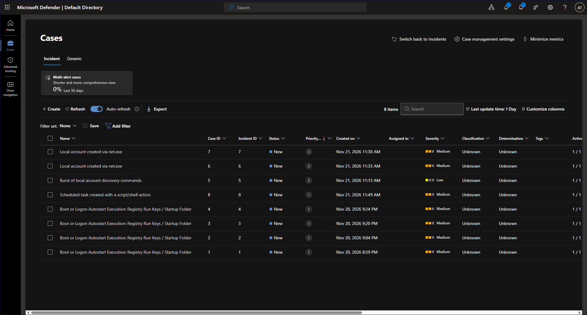
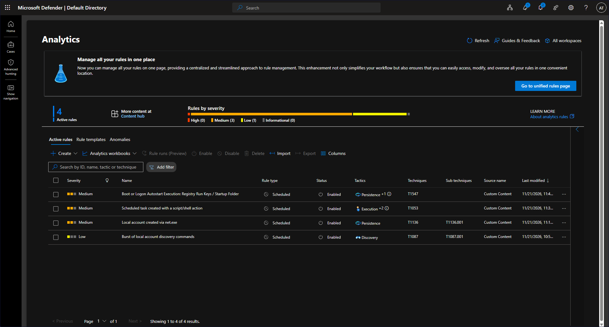

# Sentinel Detection Lab

[Deutsche Version](README.md)

A small detection lab built with **Microsoft Sentinel**. I simulated four typical attacks on a Windows server, detected them with KQL, and handled the alerts like a Tier 1 SOC analyst.

The project was built in October and November 2026.

## Results at a glance

| Metric | Value |
| --- | --- |
| Simulated techniques | 4 |
| Detection rate | 4 of 4 |
| Analytics rules | 4 |
| Incidents | 8 (from 5 activities, 3 duplicates) |
| Automation rules | 1 (tag `lab-test` and assign owner) |
| Tier 1 tickets | 3 |
| Time from activity to incident | about 6 to 14 minutes |

The numbers cover the detection tests on 20 and 21 November 2026. The later test of the automation rule created three more incidents (no. 9 to 11), which are not counted here.



## How it works

```
Windows server (VM)  ->  Azure Arc + Azure Monitor Agent  ->  Log Analytics workspace  ->  Microsoft Sentinel
   Attacks with Atomic Red Team     collects events (DCR)          stores logs              Analytics rules -> incidents
```

1. A Windows Server VM runs locally. It sends Security events and Sysmon events to Azure.
2. I run targeted attacks with **Atomic Red Team**.
3. I look for the traces in the logs with **KQL** (hunting).
4. I turn the queries into **Analytics rules**. They run every 5 minutes and create incidents.
5. I work through the incidents as a Tier 1 analyst and write tickets and a report.

Setup details: [docs/setup.md](docs/setup.md) (German)

## The four techniques

| MITRE | Technique | Event | Severity | Detected | Documentation |
| --- | --- | --- | --- | --- | --- |
| T1136.001 | Create local account | 4688 | Medium | Yes | [Attack](attacks/T1136.001.md), [KQL](detections/kql/T1136.001_local_account_creation.kql) |
| T1053.005 | Scheduled task | 4698 | Medium | Yes | [Attack](attacks/T1053.005.md), [KQL](detections/kql/T1053.005_scheduled_task.kql) |
| T1547.001 | Run key persistence | 4688 | Medium | Yes | [Attack](attacks/T1547.001.md), [KQL](detections/kql/T1547.001_run_key_persistence.kql) |
| T1087.001 | Local account discovery | 4688 | Low | Yes | [Attack](attacks/T1087.001.md), [KQL](detections/kql/T1087.001_local_account_discovery.kql) |



## Tier 1 tickets and report

The tickets and the report are written in German.

- [TICKET-001](tickets/TICKET-001.md): New account created, true positive, escalated
- [TICKET-002](tickets/TICKET-002.md): Account discovery, benign true positive, not escalated
- [TICKET-003](tickets/TICKET-003.md): Scheduled task starts a shell, true positive, escalated
- [SOC report](reports/SOC-Report.md): One-page summary

## What I learned

- An event must first be **logged**: For 4688 with command line and for 4698 I had to turn on audit policies.
- A logged event must then also **reach Sentinel**: For 4698 the filter was missing in the Data Collection Rule.
- An overlapping time range in a rule (10-minute lookback with a 5-minute schedule) creates **duplicate incidents**.
- An alert is only a statement. Whether it is an attack is decided in triage: who, what, when, and what happens before and after.

## Limitations

- All alerts come from my own tests. There was no real attack.
- The rules only detect specific paths (`net user`, `reg add`, tasks with a shell action). The same actions through PowerShell are not detected.
- No false positive comparison before and after tuning, because there is only test data.
- **Not implemented (time limit):** Playbook, workbook, Sigma rules and Splunk porting.

## Cost

The lab ran on an Azure free account with a daily cap on the workspace. After the project, the workspace and the Arc resource are deleted so that no costs occur.

## Repository structure

```
attacks/        per technique: Atomic test, command, result
detections/kql  KQL queries (hunting and rules)
tickets/        three Tier 1 tickets
reports/        SOC report
docs/           setup, architecture, event reference, project log
```
