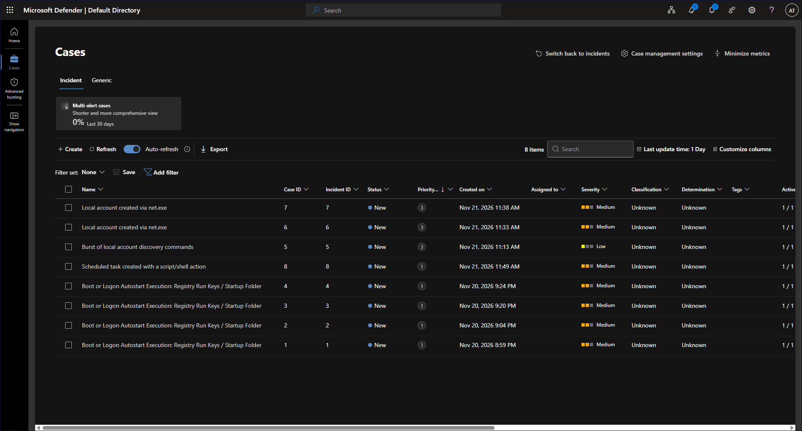
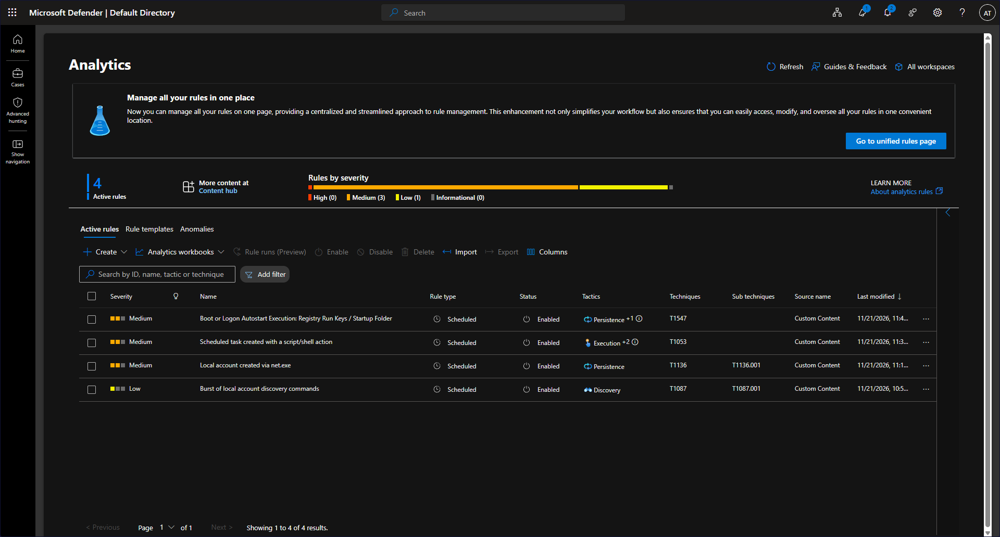

# Sentinel Detection Lab

[English version](README.en.md)

Ein kleines Detection Lab mit **Microsoft Sentinel**. Ich habe vier typische Angriffe auf einem Windows-Server simuliert, mit KQL erkannt und die Alerts wie ein SOC-Analyst (Tier 1) bearbeitet.

Das Projekt entstand im Oktober und November 2026.

## Ergebnis auf einen Blick

| Kennzahl | Wert |
| --- | --- |
| Simulierte Techniken | 4 |
| Erkennungsrate | 4 von 4 |
| Analytics Rules | 4 |
| Incidents | 8 (aus 5 Aktivitäten, 3 Duplikate) |
| Automation Rules | 1 (Tag `lab-test` und Zuweisung) |
| Tier-1-Tickets | 3 |
| Zeit von der Aktivität bis zum Incident | ca. 6 bis 14 Minuten |

Die Zahlen gelten für die Detection-Tests am 20. und 21.11.2026. Beim späteren Test der Automation Rule entstanden drei weitere Incidents (Nr. 9 bis 11), die hier nicht mitgezählt sind.



## So funktioniert es

```
Windows-Server (VM)  ->  Azure Arc + Azure Monitor Agent  ->  Log Analytics Workspace  ->  Microsoft Sentinel
   Angriffe mit Atomic Red Team     sammelt Events (DCR)          speichert Logs            Analytics Rules -> Incidents
```

1. Eine Windows-Server-VM läuft lokal. Sie sendet Security Events und Sysmon-Events nach Azure.
2. Ich führe mit **Atomic Red Team** gezielt Angriffe aus.
3. Ich suche die Spuren mit **KQL** in den Logs (Hunting).
4. Aus den Queries baue ich **Analytics Rules**. Sie laufen alle 5 Minuten und erzeugen Incidents.
5. Ich bearbeite die Incidents als Tier-1-Analyst und schreibe Tickets und einen Report.

Details zum Aufbau: [docs/setup.md](docs/setup.md)

## Die vier Techniken

| MITRE | Technik | Event | Schweregrad | Erkannt | Dokumentation |
| --- | --- | --- | --- | --- | --- |
| T1136.001 | Lokales Konto anlegen | 4688 | Medium | Ja | [Angriff](attacks/T1136.001.md), [KQL](detections/kql/T1136.001_local_account_creation.kql) |
| T1053.005 | Geplanter Task | 4698 | Medium | Ja | [Angriff](attacks/T1053.005.md), [KQL](detections/kql/T1053.005_scheduled_task.kql) |
| T1547.001 | Run-Key-Persistenz | 4688 | Medium | Ja | [Angriff](attacks/T1547.001.md), [KQL](detections/kql/T1547.001_run_key_persistence.kql) |
| T1087.001 | Konten-Abfrage (Discovery) | 4688 | Low | Ja | [Angriff](attacks/T1087.001.md), [KQL](detections/kql/T1087.001_local_account_discovery.kql) |



## Tier-1-Tickets und Report

- [TICKET-001](tickets/TICKET-001.md): Neues Konto angelegt, True Positive, eskaliert
- [TICKET-002](tickets/TICKET-002.md): Konten-Abfrage, Benign True Positive, nicht eskaliert
- [TICKET-003](tickets/TICKET-003.md): Geplanter Task startet Shell, True Positive, eskaliert
- [SOC-Report](reports/SOC-Report.md): Zusammenfassung auf einer Seite

## Was ich gelernt habe

- Ein Event muss erst **geloggt** werden: Für 4688 mit Kommandozeile und für 4698 musste ich Audit-Richtlinien einschalten.
- Ein geloggtes Event muss dann auch **in Sentinel ankommen**: Für 4698 fehlte der Filter in der Data Collection Rule.
- Ein überlappender Zeitraum einer Rule (10 Minuten Lookback bei 5 Minuten Takt) erzeugt **doppelte Incidents**.
- Ein Alert ist erst eine Aussage. Ob es ein Angriff ist, entscheidet die Triage: Wer, was, wann und was passiert davor und danach.

## Grenzen

- Alle Alerts stammen aus eigenen Tests. Es gab keinen echten Angriff.
- Die Rules erkennen nur bestimmte Wege (`net user`, `reg add`, Tasks mit Shell-Aktion). Dieselben Aktionen über PowerShell werden nicht erkannt.
- Keine Fehlalarm-Auswertung vor und nach dem Tuning, weil es nur Testdaten gibt.
- **Nicht umgesetzt (Zeitrahmen):** Playbook, Workbook, Sigma-Regeln und Splunk-Portierung.

## Kosten

Das Lab lief auf einem Azure-Free-Account mit Tageslimit (Daily Cap) im Workspace. Nach dem Projekt werden Workspace und Arc-Ressource gelöscht, damit keine Kosten entstehen.

## Repo-Struktur

```
attacks/       je Technik: Atomic-Test, Befehl, Ergebnis
detections/kql KQL-Queries (Hunting und Rules)
tickets/       drei Tier-1-Tickets
reports/       SOC-Report
docs/          Setup, Architektur, Event-Referenz, Projekt-Tagebuch
```
