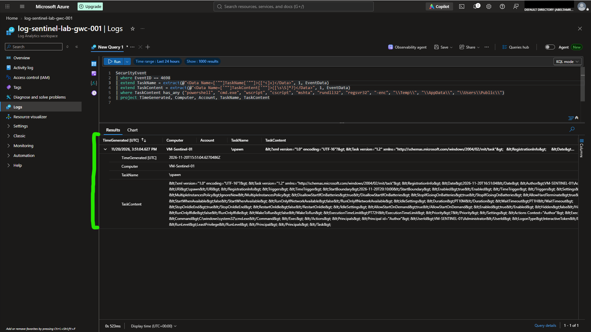

# MITRE ATT&CK

- ID: T1053.005
- Name: Scheduled Task/Job: Scheduled Task
- Taktik: Execution (TA0002), Persistence (TA0003), Privilege Escalation (TA0004)

# Atomic-Test

- T1053.005-2: Scheduled task Local (legt per `schtasks` einen einmaligen Task `spawn` an, der zur eingestellten Zeit `cmd.exe` startet)

# Voraussetzungen (Datenlücken, die ich gefunden und behoben habe)

- Audit-Subkategorie „Other Object Access Events“ (deutsch: „Andere Objektzugriffsereignisse“) war aus, daher wurde 4698 lokal nicht geschrieben. Aktiviert mit `/success:enable`.
- Event 4698 fehlte im DCR-Filter. Ergänzt mit XPath `Security!*[System[(EventID=4698)]]` (siehe `../docs/assets/DCR-EventID-4698.png`).

# Befehl

- Ausführung in PowerShell
    `Invoke-AtomicTest T1053.005 -TestNumbers 2`
- Hunting Query: [T1053.005_scheduled_task.kql](../detections/kql/T1053.005_scheduled_task.kql)
    

- Cleanup mit `Invoke-AtomicTest T1053.005 -TestNumbers 2 -Cleanup`, Verifikation mit `schtasks /query /tn spawn` (Task darf nicht mehr gefunden werden)

# Ergebnis

- Erkannt: **ja**
- Security-Event 4698 („A scheduled task was created“) erfasst: Task `\spawn`, Aktion `cmd.exe`, Ersteller `Administrator`, Trigger einmalig.
- Die Query extrahiert `TaskName` und `TaskContent` aus `EventData` und sucht nach Shell-, Skript- und LOLBin-Aktionen.
- Datenquelle laut MITRE: Data Component „Scheduled Job Creation“ (DC0001), Detection Strategy DET0441.
- Grenze: Harmlose Tasks mit `cmd.exe` oder PowerShell erzeugen ebenfalls Treffer (False-Positive-Tuning folgt).
