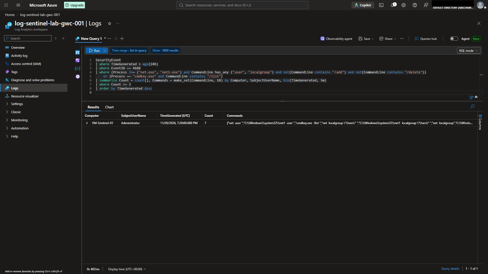

# MITRE ATT&CK

- ID: T1087.001
- Name: Account Discovery: Local Account
- Taktik: Discovery (TA0007)

# Atomic-Test

- T1087.001, Windows-Test „Enumerate all accounts on Windows (Local)“ (führt `net user`, `dir c:\Users\`, `cmdkey.exe /list`, `net localgroup "Users"` und `net localgroup` aus)

# Befehl

- Test-Nummer vorher prüfen: `Invoke-AtomicTest T1087.001 -ShowDetailsBrief` (den Windows-Test mit „Enumerate all accounts" suchen)
- Ausführung in PowerShell
    `Invoke-AtomicTest T1087.001 -TestNumbers 8`
- Hunting Query: [T1087.001_local_account_discovery.kql](../detections/kql/T1087.001_local_account_discovery.kql)
    

- Cleanup: nicht nötig, der Test liest nur (`-Cleanup` ist harmlos).

# Ergebnis

- Erkannt: Ja
- Die Prozesse `net.exe`, `net1.exe` und `cmdkey.exe` werden im Security Log als EventID 4688 mit Kommandozeile erfasst. Die Query zählt sie pro Konto in 5-Minuten-Fenstern und meldet ab 3 Befehlen.
- Grenze: Ein einzelnes `net user` löst nichts aus (bewusst, wegen False Positives). PowerShell-Varianten (`Get-LocalUser`) sind nicht abgedeckt.
