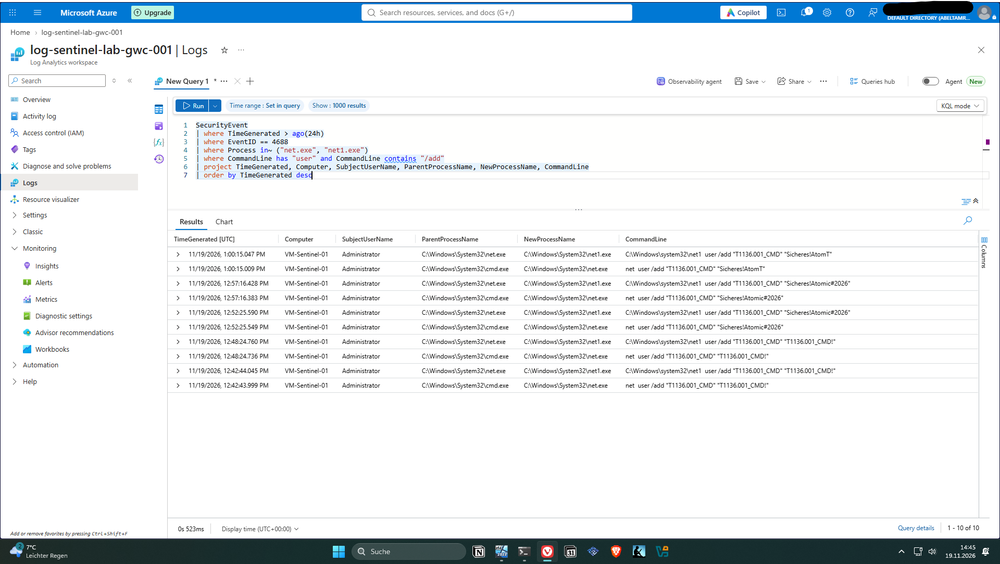

# MITRE ATT&CK

- ID: T1136.001
- Name: Local Account (Unter-Technik von T1136, Create Account)
- Taktik: Persistence (TA0003)

# Atomic-Test

- T1136.001-4: Create a new User in the command prompt

# Befehl

- Ausführung in Powershell
    `Invoke-AtomicTest T1136.001 -TestNumbers 4 -InputArgs @{password="[]"}`
- Wie im Bild zu sehen ist, wurde die Attacke anhand Hunting Query ([kql query](../detections/kql/T1136.001_local_account_creation.kql)) erkannt
    

- Cleanup mit `Invoke-AtomicTest T1136.001 -TestNumbers 4 -Cleanup` und
Verifikation mit `net user` in der VM, dass der Benutzer gelöscht wurde

# Ergebnis

- Ein neuer User wurde hinzugefügt `net user`
- Process wurde im Security Log EventID: 4688 erfasst (siehe oben)
