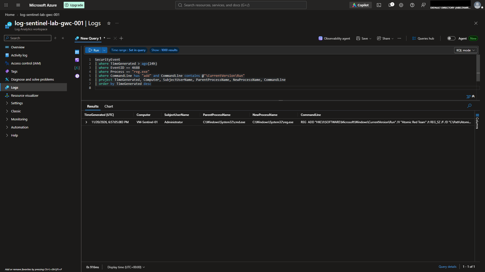

# MITRE ATT&CK

- ID: T1547.001
- Name: Boot or Logon Autostart Execution: Registry Run Keys / Startup Folder
- Taktik: Persistence (TA0003), Privilege Escalation (TA0004)

# Atomic-Test

- T1547.001-1: Reg Key Run (legt per `reg add` einen Wert unter `HKCU\...\CurrentVersion\Run` an, damit ein Programm bei jedem Logon startet)

# Befehl

- Test-Nummer vorher prüfen: `Invoke-AtomicTest T1547.001 -ShowDetailsBrief`
- Ausführung in PowerShell
    `Invoke-AtomicTest T1547.001 -TestNumbers 1`
- Hunting Query: [T1547.001_run_key_persistence.kql](../detections/kql/T1547.001_run_key_persistence.kql)
    

- Cleanup mit `Invoke-AtomicTest T1547.001 -TestNumbers 1 -Cleanup`, Verifikation mit `reg query "HKCU\Software\Microsoft\Windows\CurrentVersion\Run"` (der Wert „Atomic Red Team“ darf nicht mehr vorhanden sein)

# Ergebnis

- Erkannt: Ja
- Process wurde im Security Log EventID 4688 erfasst: `reg.exe` mit Kommandozeile `add ... \CurrentVersion\Run`.
- Grenze: Die Query erkennt nur `reg.exe`. Schreibzugriffe per PowerShell oder API sieht man besser mit Sysmon Event 13 (Registry Value Set).
