# Progress

## 2026-11-20 Woche 4 (Testen der ersten Atomic Tests)

### Erledigt
- Gemerkt dass für EventID 4698 'Other Object Access Events' aktiviert sein
muss, sonst wird der Scheduled Task nicht protokolliert
    - `auditpol /get /subcategory:"Other Object Access Events"` zum prüfen ob
aktiv oder nicht
    - Gemerkt nicht aktiv -> aktiviert mit `auditpol /set /subcategory:"OtherObject Access Events" /success:enable`
- EventID 4698 nicht in Azure Sentinel angekommen, obwohl in der VM im
Eventviewer zu sehen
    - DCR angepasst mit XPath Filter `Security!*[System[(EventID=4698)]]`
    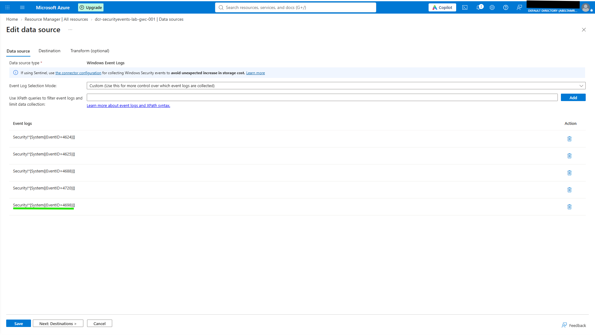
- Attacke wurde erfolgreich erkannt und im Security Log EventID:4698 erfasst
- Hunting Query ([kql query](../detections/kql/T1053.005_scheduled_task.kql))
angepasst und erfolgreich getestet

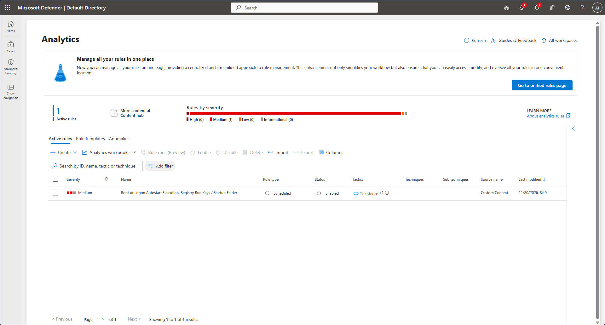

- Microsoft Sentinel Incident Proof of Detection of T1547.001-1 (Registry Run
Key / Startup Folder)
    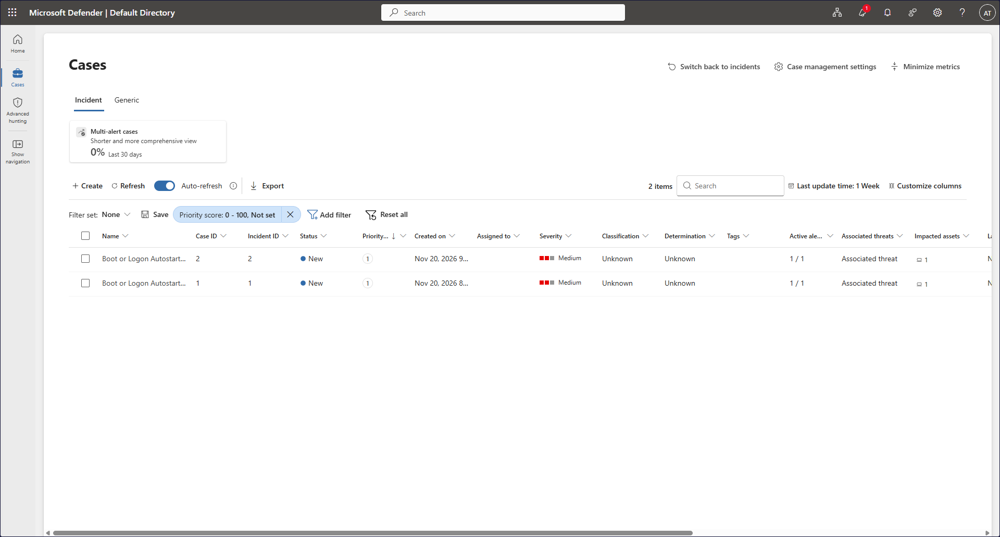

### Erledigt

## 2026-11-19 Woche 4 (Testen der ersten Atomic Tests)

### Erledigt
- Ersten Test laufen lassen mit dem Befehl `Invoke-AtomicTest T1136.001 -TestNumbers 4`
    - Fehlermeldung: Kennwort nicht lang genug bei ausführen von
`Invoke-AtomicTest T1136.001 -TestNumbers 4` ohne Anpassung von Password
    - Neuer command: 'Invoke-AtomicTest T1136.001 -TestNumbers 4 -InputArgs @{password="[]"}'
- In Azure geprüft ob der Angriff protokolliert wird
    - Query:
        ```kql
        SecurityEvent
        | where TimeGenerated > ago(24h)
        | where EventID == 4688
        | where Process in~ ("net.exe", "net1.exe")
        | where CommandLine has "user" and CommandLine contains "/add"
        | project TimeGenerated, Computer, SubjectUserName, ParentProcessName, NewProcessName, CommandLine
        | order by TimeGenerated desc
        ```
    - Wie im Bild zusehen ist wurde der Angriff erkannt
        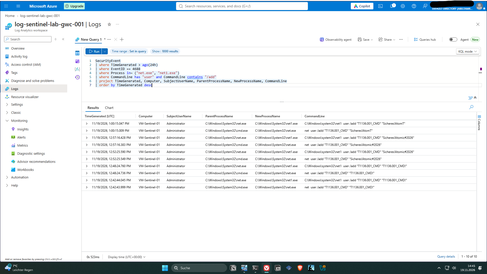
    - Cleanup mit `Invoke-AtomicTest T1136.001 -TestNumbers 4 -Cleanup` und
Verifikation mit `net user` in der VM, dass der Benutzer gelöscht wurde

## 2026-11-14 Woche 3 (Installation of Atomic Red Team)

### Erledigt
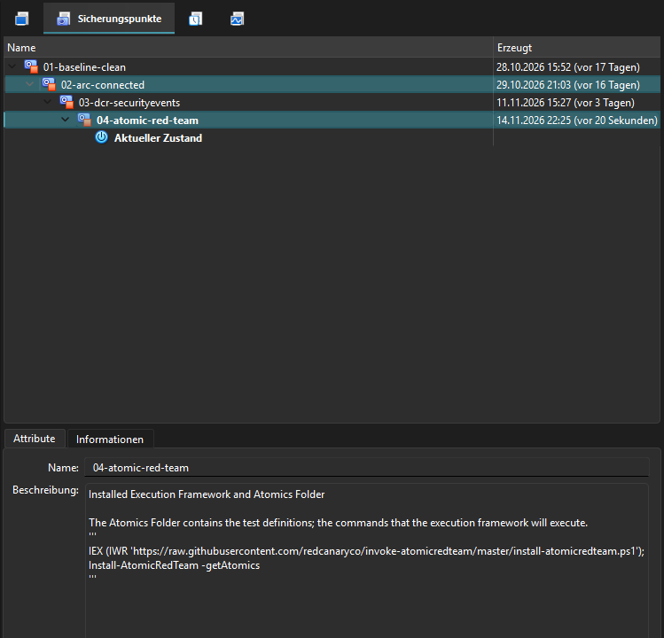
- Installed Atomic Red Team on my VM using Powershell as Admin and running the
code 'IEX (IWR 'https://raw.githubusercontent.com/redcanaryco/invoke-atomicredteam/master/install-atomicredteam.ps1' -UseBasicParsing);
Install-AtomicRedTeam -getAtomics'
    - Windows Defender automatically removed incidents from the Atomic folder
which are ment to be used for testing
    - Added the Atomic folder to the Windows Defender Exclusion list
    - Reinstalled Atomic Red Team using 'IEX (IWR 'https://raw.githubusercontent.com/redcanaryco/invoke-atomicredteam/master/install-atomicredteam.ps1' -UseBasicParsing);
Install-AtomicRedTeam -getAtomics -Force'

## 2026-11-11 Woche 3 (DCR Security Events)

### Erledigt
- Created DCR for Windows Security Events via AMA (connected to VM)
    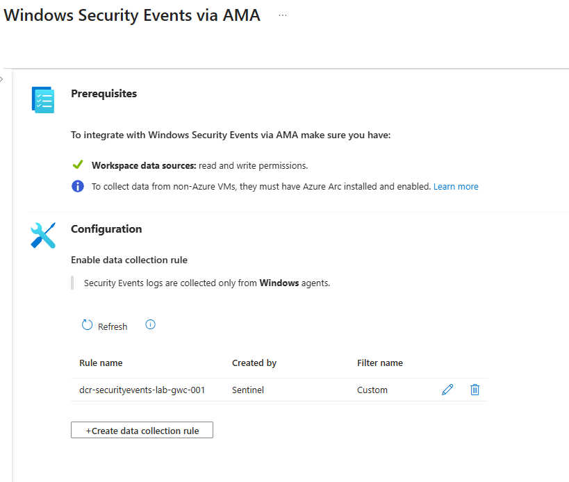
    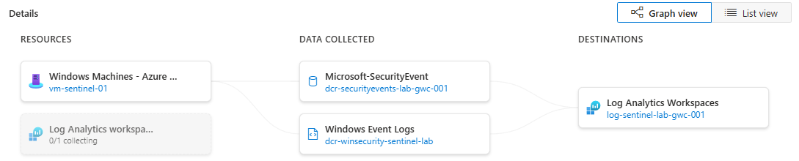
- Checked if Security Events are arriving in the Log Analytics Workspace
    ```kql
    SecurityEvent
    | summarize count () by EventID
    ```
- Stand Prozesserstellung geprüft mit `auditpol /get /subcategory:"Prozesserstellung"`
    - Ergebnis: Nicht aktiviert
    - Mit `auditpol /set /subcategory:"Prozesserstellung" /success:enable`
aktiviert
- Kommandozeile Richtlinie aktiviert gpedit.msc
    - Computerkonfiguration > Administrative Vorlagen > System >
Prozesserstellung überwachen > Befehlszeile in Prozesserstellungsereignisse
einschließen > Aktiviert
gesetzt
- Im cmd die Richtlinie mit gpupdate /force aktualisiert
- Im Eventviewer geprüft, dass die Richtlinie aktiv ist (Event ID 4688)
    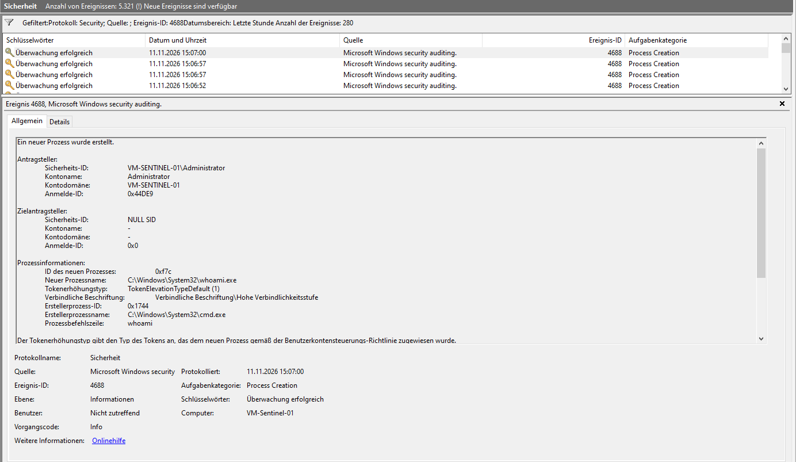
- Gecheckt ob Event ID in Azure Sentinel ankommt
    - Query:
        ```kql
        SecurityEvent
        | where EventID == 4688
        | summarize count() by Computer, EventID, bin(TimeGenerated, 1h)
        | order by TimeGenerated desc
        ```
    - Ergebnis: Event ID 4688 kommt an
        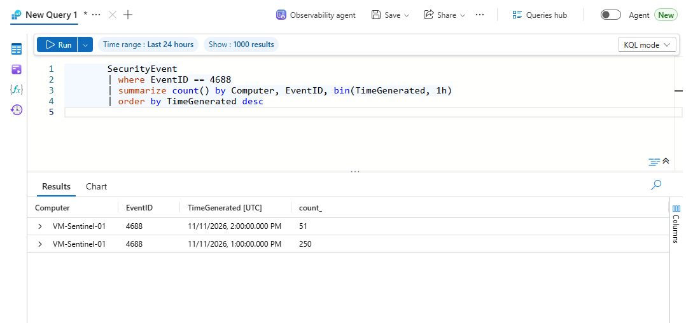

## 2026-11-07 Woche 2 (DCR für Sysmon)

### Erledigt

- Check Agent installiert
    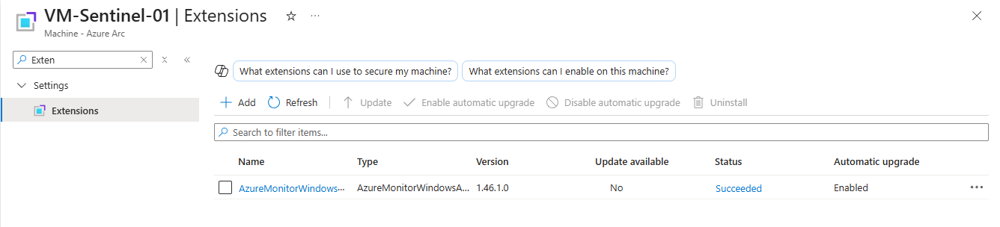
- Prüfung ob Agent Daten an den Workspace sendet
    - Tool: log_analytics_query
    - Resource: /subscriptions/[...]/resourcegroups/rg-sentinel-lab-gwc-001/providers/microsoft.operationalinsights/workspaces/log-sentinel-lab-gwc-001
    - Time window: 2026-11-06T13:20:44.0000000Z .. 2026-11-07T13:20:44.0000000Z
    - Query:
        ```kql
        Heartbeat
        | where TimeGenerated >= datetime(2026-11-06T13:20:44Z) and TimeGenerated < datetime(2026-11-07T13:20:44Z)
        | summarize Heartbeats=count(), FirstSeen=min(TimeGenerated), LastSeen=max(TimeGenerated) by Computer, ResourceId, ResourceType, OSType, SourceSystem
        | extend MinutesSinceLastSeen = datetime_diff('minute', datetime(2026-11-07T13:20:44Z), LastSeen)
        | order by LastSeen desc
        | take 20
        ```
    - Ergebnistabelle
        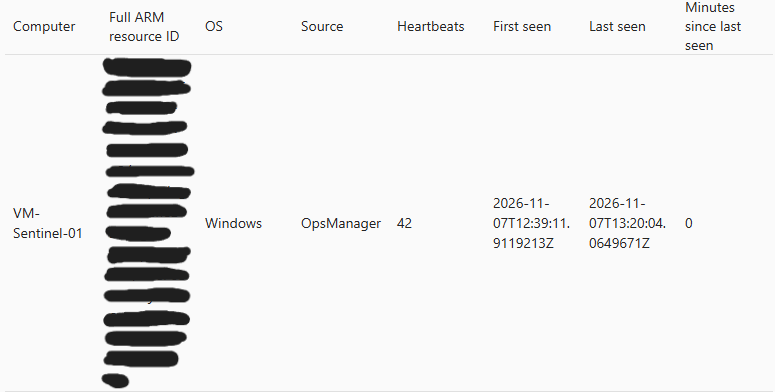

#### Schritt für Schritt DCR für Sysmon angelegt:
- Ressource auf VM-SENTINEL-01 gesetzt, Resource Type: Machine - Azure Arc
    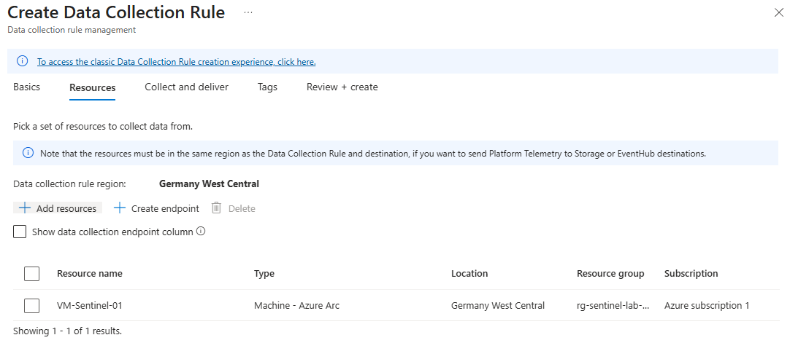
- DCR für Sysmon, Data Source auf Windows Event Log
gesetzt, Filter auf die Event IDs 1, 3, 10, 11, 13 (Sysmon)
    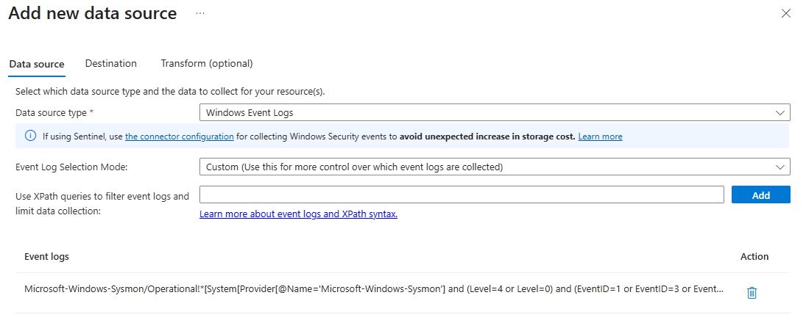
- Destination auf Log Analytics Workspace gesetzt
    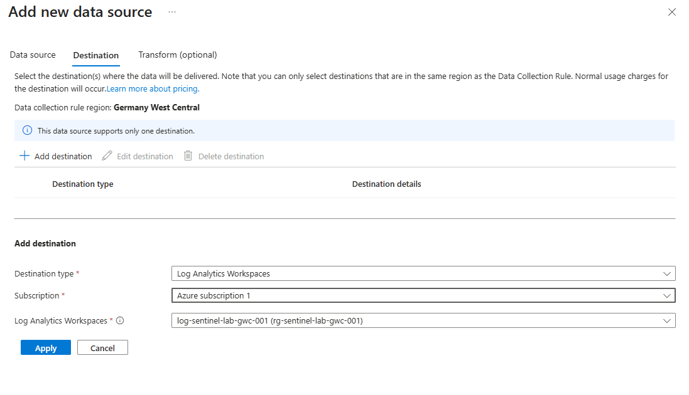

- Geprüft das Sysmon Events im Workspace ankommen
    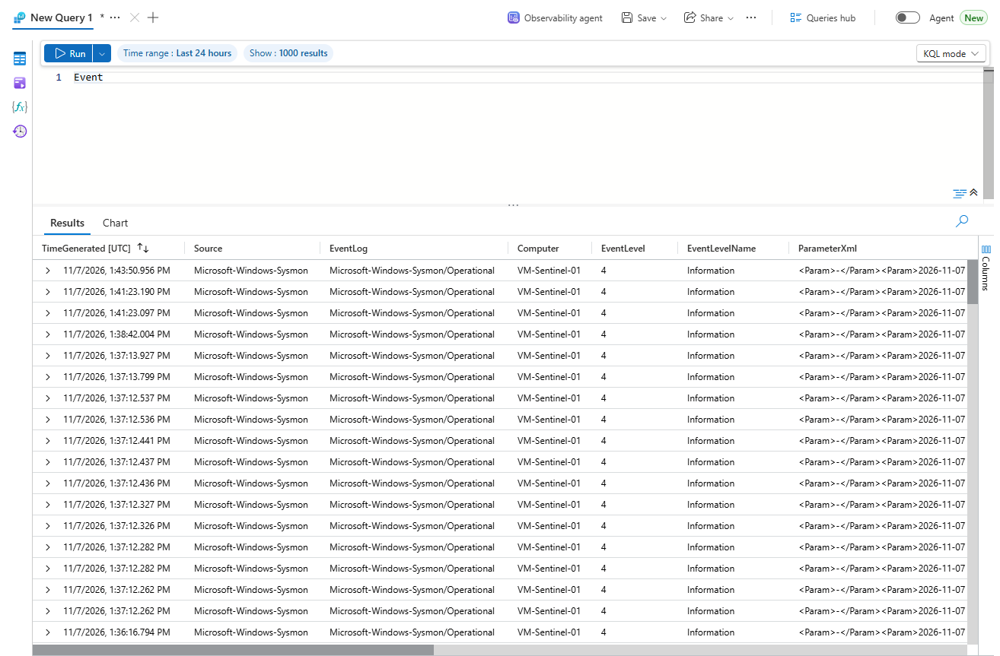

### Offen
- Security-Events-DCR
- Prüfung ob 1GB Daily Cap für Sysmon und Security Events ausreicht

## 2026-11-05 - Woche 2 (Event 10 narrowing down)

### Erledigt
- Gemerkt das Event ID 10 (Process Access) sehr viele Events erzeugt, auch wenn
nur lsass.exe überwacht wird.
- Eingrenzung Schritt für Schritt begonnen mit taskmgr.exe
    ```xml
        <RuleGroup name="" groupRelation="and">
                <ProcessAccess onmatch="exclude">
                    <SourceImage condition="image">C:\Windows\system32\taskmgr.exe</SourceImage>
                    <GrantedAccess condition="is">0x1400</GrantedAccess>
                </ProcessAccess>
            </RuleGroup>
    ```

## 2026-11-04 - Woche 2 (Einrichtung config file für Sysmon)
### Erledigt
- Ergänzungen für Event ID 10 vorgenommen um einkommenden Verkehr zu lsass.exe zu erkennen (Credential dumping)
    ```xml
    <!--SYSMON EVENT ID 10 : INTER-PROCESS ACCESS [ProcessAccess]-->
            <!--EVENT 10: "Process accessed"-->
            <!--COMMENT:	Can cause high system load, disabled by default.-->
            <!--COMMENT:	Monitor for processes accessing other process' memory.-->

            <!--DATA: UtcTime, SourceProcessGuid, SourceProcessId, SourceThreadId, SourceImage, TargetProcessGuid, TargetProcessId, TargetImage, GrantedAccess, CallTrace-->
        <RuleGroup name="" groupRelation="or">
            <ProcessAccess onmatch="include">
                <TargetImage condition="image">lsass.exe</TargetImage>
            </ProcessAccess>
        </RuleGroup>
    ```


## 2026-11-03 - Woche 2 (Installation und Einrichtung Sysmon und DCR)
### Erledigt
- sysmon64 auf VM-SENTINEL-01 installiert
    - Sysmon64 von Microsoft Sysinternals installiert
    - in der VM cmd mit Administrator Rechten sysmon64 -accepteula -i ausgeführt
    - Geprüft welche Ereignisse bereits laufen 1,4,5,16

### Offen
- Config besorgen, prüfen, mit -c einspielen
- DCR anlegen
- Tabelle Event oder WindowsEvent an der DCR prüfen

## 2026-10-29 - Woche 1, Tag 3 (Azure Arc Onboarding)

### Erledigt
- Resource Provider in der Subscription registriert (Portal):
`Microsoft.HybridCompute`, `Microsoft.GuestConfiguration`,
`Microsoft.HybridConnectivity`, `Microsoft.AzureArcData`.
`Microsoft.HybridCompute` war vorher nicht registriert.
- Onboarding-Skript im Portal erzeugt: Public endpoint, SQL-Server-Option aus,
kein Proxy, kein Arc Gateway, Automatic agent upgrade an. Essential Machine
Management nicht aktiviert.
- Skript per Shared Clipboard (nur Host zu Gast) in die VM gebracht. Arc-Agent
installiert ("Installation of azcmagent completed successfully").
- Gerätecode-Login scheiterte (Error 530035). Ursache laut Entra Sign-in-Log:
"Access has been blocked by security defaults".
- Azure CLI auf dem Host installiert, Access Token auf dem Host erzeugt,
`azcmagent connect` in der VM mit `--access-token` statt `--use-device-code`
ausgeführt.
- `VM-SENTINEL-01` steht im Portal unter Azure Arc auf `Connected`.
- Aufgeräumt: Token-Variable und PowerShell-Historie in der VM gelöscht,
Clipboard deaktiviert, `az logout` auf dem Host.
- Snapshot `02-arc-connected` erstellt (VM vorher heruntergefahren).

### Entscheidungen
- Public endpoint statt Private Endpoint: Die VM baut nur ausgehende
HTTPS-Verbindungen auf, Private Endpoint wäre kostenpflichtig und unnötig.
- Security Defaults bleiben aktiv: Kein Abschalten zugunsten des
Gerätecode-Logins, weil das Konto mit hinterlegter Kreditkarte geschützt bleiben
soll.
- Token vom Host statt Browser-Login oder Service Principal Secret in der VM:
Die VM wird später absichtlich angegriffen (u. a. Credential-Dumping), also soll
kein dauerhaftes Passwort oder Secret dort liegen. Das Token ist kurzlebig.
- Clipboard nur Host zu Gast und nach dem Kopieren wieder deaktiviert.
- Snapshot bei ausgeschalteter VM, damit kein Token im gespeicherten
Arbeitsspeicher steckt.

### Offen
- DCRs für Security Events und Sysmon
(`Microsoft-Windows-Sysmon/Operational!*`), Sysmon auf der VM installieren.
- Sentinel erst aktivieren, wenn die Datenpfade stehen.
- Datenprüfung: 4624, 4625, 4688, 4720; Sysmon 1, 3, 10, 11, 13.
- Prüfen, welche Datentypen das Daily Cap nicht begrenzt.
- Ursache der langen Installationsdauer des Agent-Pakets ungeklärt (msiexec lief
nicht, Windows Update ungeprüft).
- Aufräumliste für den 22.11. ergänzen: Workspace, Alert Rule, Action Group,
Arc-Ressource löschen, Azure CLI vom Host deinstallieren, erhöhten Zugriff (User
Access Administrator auf Root-Scope) prüfen und zurücknehmen.

### Naechster Schritt
- Sysmon in der VM installieren und DCR für Security Events anlegen.

### Gelernt
- Welche Resource Provider Arc braucht und wo man den Registrierungsstatus pro
Subscription sieht.
- Public endpoint, Proxy und Arc Gateway: wann man sie braucht und warum nicht
in diesem Lab.
- Security Defaults blockieren den Gerätecode-Login. Das Sign-in-Log (Entra,
Monitoring) zeigt die Ursache.
- Snapshots in VirtualBox bilden einen Baum, `02` hängt unter `01`. Zurück auf
`01`: Arc-Ressource in Azure bleibt verwaist. Zurück auf `02`: Änderungen danach
(Sysmon, Atomic-Tests) gehen verloren.
- Ein Token ist wie ein Passwort: kurzlebig, nicht in Chat, Repo oder Historie.

## 2026-10-28 - Woche 1, Tag 2 (VM aufgebaut)

### Erledigt
- Windows Server Evaluation VM (2022) VirtualBox aufgebaut | 4 GB RAM | 2 CPUs |
50 GB Festplatte | Ablauf: 180 Tage (26. April 2027) innerhalb Projektscope
- Sicherungspunkt erstellt

### Entscheidungen
- NAT gewählt, weil alle Verbindungen im Lab von der VM ausgehen (Arc-Agent und
Azure Monitor Agent nach Azure, Updates, Atomic-Red-Team-Download).
- Eingehende Verbindungen zur VM bräuchten Port Forwarding in VirtualBox. Das
richte ich nicht ein: Die VM wird später absichtlich angegriffen und soll aus
dem Heimnetz und dem Internet nicht erreichbar sein.
- Hostname: VM-SENTINEL-01
- Sicherungspunkt `01-baseline-clean`: sauberer Ausgangszustand, auf den ich bei
Fehlern (Konfiguration, Angriffssimulation) zurückgehe.

### Offen
- Azure Arc Onboarding (Essential Machine Management nicht aktivieren).
- DCRs fuer Security Events und Sysmon.
- Sentinel erst nach VM und Arc aktivieren.
- Datenpruefung: 4624, 4625, 4688, 4720; Sysmon 1, 3, 10, 11, 13.
- Pruefen, welche Datentypen das Daily Cap nicht begrenzt.
- Alert Rule auf die Aufraeumliste fuer den 22.11. setzen (Workspace, Alert
Rule, Action Group, Arc-Ressource loeschen).

### Naechster Schritt
- Azure Arc Onboarding (Essential Machine Management nicht aktivieren).

### Gelernt
- Wie man in VirtualBox eine VM aufbaut und konfiguriert.
- Dass man bei Windows Server Evaluation "Desktop Experience" statt Server Core
wählen muss, wenn man eine GUI will. Server Core zeigt nur die Konsole (sconfig)
und lässt sich unter 2022 nicht nachträglich umstellen.
- Dass die unbeaufsichtigte Installation in VirtualBox die Meldung "Microsoft
Software License Terms nicht gefunden" auslöste. Lösung: "Skip Unattended
Installation" und die Installation manuell durchführen.
- Die unterschiedlichen Netzwerkmodi (NAT, Bridged, Host-only) und deren Vor-
und Nachteile.
- NAT: Die VM baut Verbindungen nach außen auf, die NAT-Tabelle ordnet die
Antworten der VM zu. Von außen kann niemand eine Verbindung zur VM starten,
solange kein Port Forwarding existiert. Für Arc genügt das, weil der Agent die
Verbindung (HTTPS) nach Azure aufbaut, nicht umgekehrt.

## 2026-10-27 - Woche 1, Tag 1 (Plumbing)

### Erledigt
- Azure Free Account angelegt, nicht auf Pay-as-you-go hochgestuft.
- Resource Group `rg-sentinel-lab-gwc-001` angelegt (Region Germany West
Central).
- Log-Analytics-Workspace `log-sentinel-lab-gwc-001` angelegt, Pricing Tier
Pay-as-you-go.
- Daily Cap auf 1 GB pro Tag gesetzt.
- Action Group `ag-sentinel-lab-001` mit E-Mail-Benachrichtigung angelegt.
- Alert Rule "Daily data limit reached" (Severity 2, Warning) angelegt: Custom
Log Search auf `_LogOperation`, Table rows, Count, Schwelle 0, Auswertung alle 5
Minuten. Preis laut Anzeige ca. 1,50 $.

### Entscheidungen
- Namensmuster: `<Typkuerzel>-sentinel-lab-<Region>-<Nummer>`.
- Daily Cap 1 GB: Schaetzung fuer eine Windows-Server-VM mit Security Events und
Sysmon. Nach einigen Tagen mit echten Nutzungsdaten pruefen und anpassen.
- Severity Warning, weil die Doku es so vorgibt.

### Offen
- Windows Server Evaluation VM einrichten.
- Azure Arc Onboarding (Essential Machine Management nicht aktivieren).
- DCRs fuer Security Events und Sysmon.
- Sentinel erst nach VM und Arc aktivieren.
- Datenpruefung: 4624, 4625, 4688, 4720; Sysmon 1, 3, 10, 11, 13.
- Pruefen, welche Datentypen das Daily Cap nicht begrenzt.
- Alert Rule auf die Aufraeumliste fuer den 22.11. setzen (Workspace, Alert
Rule, Action Group, Arc-Ressource loeschen).

### Naechster Schritt
- Lokale Windows Server VM vorbereiten (4-6 GB RAM).

### Gelernt
- Wie man eine Resource Group und Log-Analytics-Workspace in Azure erstellt.
- Wie man eine Daily Cap fuer einen Log-Analytics-Workspace setzt.
- Wie man ein Alert Rule mit einer Action Group erstellt.
    - Nachricht über Mail
